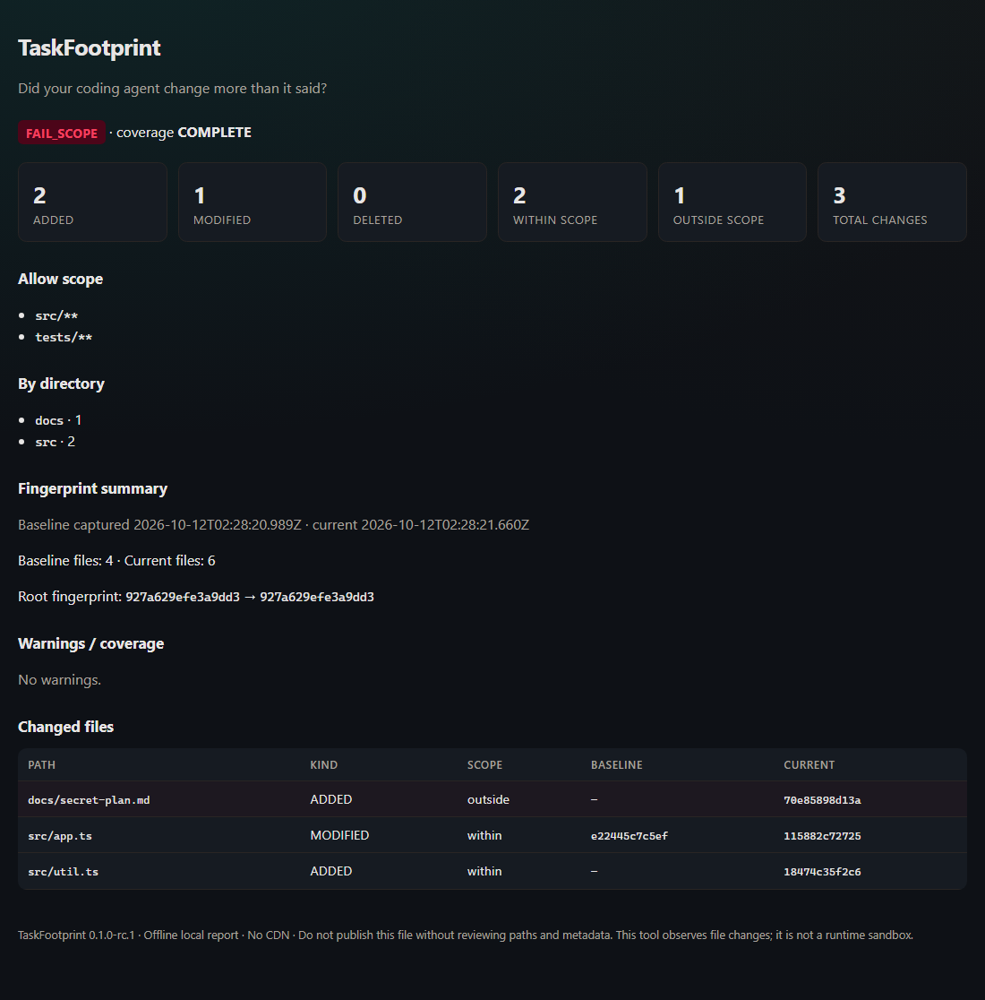

# TaskFootprint

**Did your coding agent change more than it said?**

```text
Snapshot → Agent work → Check → Offline Report
```

TaskFootprint captures a **content-hash baseline** of your workspace, lets any AI coding agent work, then compares the current tree against that baseline. It flags out-of-scope edits and writes an offline HTML / JSON / Markdown report.

Local-first · No AI API · No cloud upload · Agent-agnostic · MIT · Pre-release

> Status: **0.1.0-rc.1** on GitHub. **npm Registry: not published.** This tool **observes** file changes — it is **not** a runtime sandbox and cannot stop dangerous agent commands.

## Why not just `git diff`?

Coding agents under-report change sets ([Codex #45471](https://github.com/openai/codex/issues/45471), [#11985](https://github.com/openai/codex/issues/11985), [#22824](https://github.com/openai/codex/issues/22824)). Diff-from-HEAD also mixes **pre-existing dirty files** into the same bucket as agent edits.

TaskFootprint answers a narrower question:

> Between these two moments, which files actually changed — and were they inside the allow scope?

If `README.md` was already dirty before the task and the agent never touched it again, it will **not** appear as an interval change.

## Quick start — demo

Requires Node.js `^22.12.0 || ^24.0.0`.

```bash
git clone https://github.com/flower1201/taskfootprint.git
cd taskfootprint
npm install
npm run demo
```

Open `examples/out-demo/index.html` via `file://`. You should see a **FAIL_SCOPE** verdict because the synthetic agent also wrote `docs/secret-plan.md` outside `src/**` + `tests/**`.



## CLI

```bash
npm run build

# 1) Before the agent runs
node ./dist/cli/index.js snapshot . --out baseline.json

# 2) Run Claude Code / Codex / Cursor / anything else

# 3) After the agent finishes
node ./dist/cli/index.js check . \
  --baseline baseline.json \
  --allow "src/**" \
  --allow "tests/**" \
  --out ./report
```

Outputs:

```text
report/
├── index.html
├── changes.json
└── summary.md
```

### Exit codes

| Code | Meaning |
|-----:|---------|
| 0 | Check passed (complete coverage, no scope violations) |
| 1 | Execution error or incomplete snapshot/check |
| 2 | Confirmed out-of-scope (or indeterminate-scope) changes |

### Useful flags

| Flag | Command | Meaning |
|------|---------|---------|
| `--out` | snapshot / check | Baseline file or report directory |
| `--allow <glob>` | check | Repeatable allow patterns |
| `--include-ignored <path>` | both | Explicit opt-in for a gitignored path |
| `--json` | check | Machine-readable summary on stdout |
| `--help` / `--version` | root | Standard CLI metadata |

## What is scanned

Included by default (git repos):

- Tracked files
- Non-ignored untracked files
- Already-dirty / staged content (via content hashes, not HEAD-only)

Excluded by default:

- `.git` objects
- `node_modules`, build caches
- Gitignored sensitive files (unless `--include-ignored`)
- Symlinks pointing outside the repo

Snapshots store **relative paths + hashes + sizes** — not source file bodies.

## Privacy

- No network calls in normal operation
- Absolute paths and secret values are not written into reports
- Treat baselines/reports as local workspace metadata before sharing
- See [SECURITY.md](./SECURITY.md)

## Competitors (short)

Scope/diff gates like [agent-scope-guard](https://github.com/manuelsampedro1/agent-scope-guard) and merge-time packs like [patchwitness](https://github.com/pangxueyuan2-creator/patchwitness) solve related jobs. TaskFootprint’s wedge is **time-bounded content-hash baselines** with correct pre-dirty interval semantics. Details: [docs/COMPETITORS.md](./docs/COMPETITORS.md).

## Development

```bash
npm install
npm run typecheck
npm test
npm run build
```

## License

MIT · Copyright (c) 2026 flower1201
